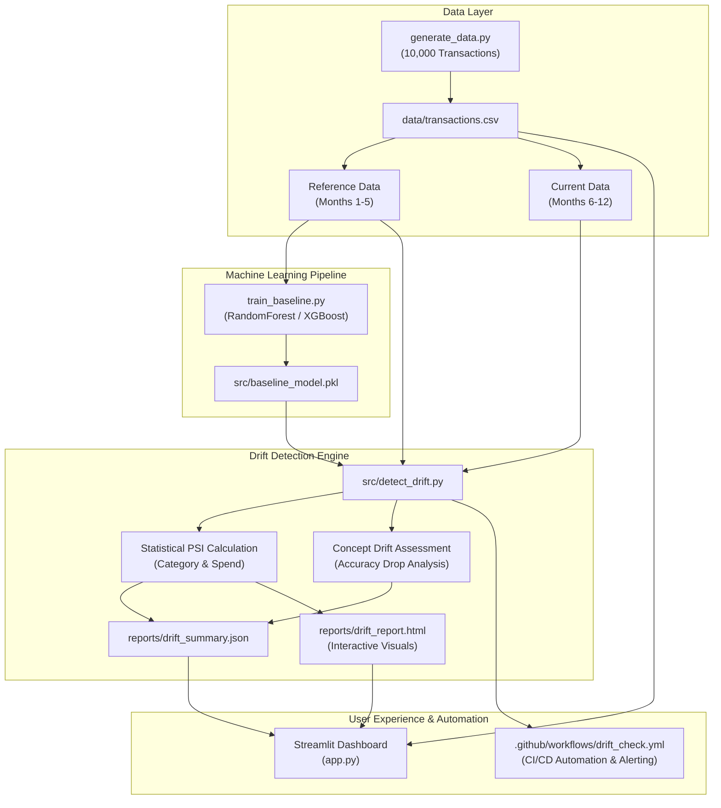

# Customer Purchasing Behavior Shift Detection System

An enterprise-ready early-awareness machine learning monitoring and drift detection system. This project simulates real-world retail behavioral shifts, monitors statistical population drift using Population Stability Index (PSI), tracks predictive model degradation (concept drift), and presents actionable insights via an interactive Streamlit dashboard and automated CI/CD pipelines.

---

## 📌 Problem Statement

In modern e-commerce and retail environments, customer preferences and purchasing habits are volatile. Macroeconomic fluctuations, supply chain disruptions, seasonal transitions, or emerging lifestyle trends can suddenly alter spending behavior across product categories.

Traditional machine learning models deployed in production silently degrade over time because they assume future incoming data will mirror historical training data:
- **Data Drift (Covariate Shift):** The distribution of input features (e.g., purchase categories, spend amounts) changes significantly.
- **Concept Drift:** The statistical relationship between input features and target outcomes evolves, causing severe degradation in model prediction accuracy.

Without an automated **Early Awareness Monitoring System**, businesses suffer:
1. **Misallocated Inventory:** Overstocking declining categories (e.g., Electronics) while stocking out of trending categories (e.g., Home Goods).
2. **Silent Model Failure:** Predictive models continue scoring transactions with stale confidence, misleading pricing engines and recommendation systems.
3. **Delayed Reaction:** Traditional quarterly reporting discovers shifts months after substantial revenue and customer churn have occurred.

This system provides automated continuous monitoring, early detection alerting, visual drift reporting, and interactive simulation.

---

## 🚦 3-Tier PSI Alerting Logic

The **Population Stability Index (PSI)** measures the divergence between a baseline reference distribution ($R$) and a current target distribution ($C$):

$$\text{PSI} = \sum_{i=1}^{k} (C_i - R_i) \times \ln\left(\frac{C_i}{R_i}\right)$$

Where $R_i$ and $C_i$ represent the proportion of transactions falling into category or bin $i$.

| Status | PSI Range | Description & Business Action |
| :--- | :--- | :--- |
| 🟢 **Green (Stable)** | $\text{PSI} < 0.10$ | **No Significant Shift.** Customer behavior aligns with training distribution. Model outputs remain reliable. No intervention required. |
| 🟡 **Amber (Early Warning)** | $0.10 \le \text{PSI} \le 0.25$ | **Early Awareness Warning.** Moderate shift detected. Spend reallocation observed between categories. Inventory teams should rebalance stock; ML teams should flag models for scheduled retraining. |
| 🔴 **Red (Critical)** | $\text{PSI} > 0.25$ | **Significant / Critical Shift.** Drastic distributional change. High risk of complete model failure. Automated rollback or immediate emergency model retraining triggered. |

### Injected Shift Case Study
In this project:
- **Injected Shift at Month 6:** Electronics purchase probability drops by 50%, while Home Goods spikes by 70%.
- **Category PSI Result:** **0.1749** $\rightarrow$ Triggers the **Amber Early Awareness Warning**.
- **Category Share Swings:**
  - **Electronics:** $29.99\% \rightarrow 15.16\%$ (**↓ 49.4%**)
  - **Home Goods:** $20.43\% \rightarrow 34.36\%$ (**↑ 68.2%**)
- **Concept Drift:** Random Forest baseline model accuracy plummets from **81.72%** on pre-shift data down to **62.61%** on post-shift data (**19.11 percentage point drop**), surpassing the 5 pp concept drift threshold.

---

## 🏗️ Architecture & Workflow



---

## 🏢 Technology Mapping: Open-Source vs. IBM Enterprise Stack

This solution mirrors the enterprise AI governance and data architecture established by IBM's flagship analytics and AI platforms:

| Solution Component | Open-Source Implementation (This Project) | IBM Enterprise Platform | Role in Enterprise Architecture |
| :--- | :--- | :--- | :--- |
| **Data Lake & Ingestion** | Pandas, NumPy, CSV Storage | **IBM watsonx.data** | Scalable lakehouse engine built on Apache Iceberg and Presto; provides unified data ingestion, schema enforcement, and query federation across multi-cloud environments. |
| **Predictive Modeling** | Scikit-Learn (RandomForest), XGBoost | **IBM watsonx.ai** | Next-generation studio for training, fine-tuning, and serving both classical machine learning and generative foundation models with full lineage tracking. |
| **Drift Detection & Governance** | Custom PSI Engine, Evidently AI | **IBM watsonx.governance** | Enterprise-grade automated governance lifecycle; continuously monitors model health, fairness/bias, explainability, data drift, and concept drift with compliance audits. |
| **Continuous Integration & Ops** | GitHub Actions (`drift_check.yml`) | **Red Hat OpenShift Pipelines / IBM Event Streams** | Production CI/CD, scheduled drift evaluation, event-driven retrain webhooks, and automated Kubernetes container deployments. |
| **Operational Dashboard** | Streamlit, Plotly Visualizations | **IBM Cognos Analytics / Cloud Pak for Data** | Executive BI dashboards, interactive parameter simulation, alert distribution, and enterprise role-based access management. |

---

## 🚀 Local Quickstart Guide

Follow these steps to run the pipeline and interactive dashboard locally.

### 1. Prerequisites
- Python 3.10+ (tested on Python 3.12)
- Git

### 2. Clone Repository & Set Up Virtual Environment

```bash
git clone https://github.com/<your-username>/<your-repo-name>.git
cd "IBM Project"

# Create and activate a virtual environment
python -m venv .venv

# On Windows (PowerShell):
.venv\Scripts\Activate.ps1
# On Linux / macOS:
# source .venv/bin/activate
```

### 3. Install Dependencies

```bash
pip install --upgrade pip
pip install -r requirements.txt
```

### 4. Generate Synthetic Dataset

Generates 10,000 transactions across 12 months with the month 6 behavioral shift:

```bash
python generate_data.py
```
*Output: `data/transactions.csv`*

### 5. Train Baseline Category Model

Trains a predictive Random Forest classifier strictly on the pre-shift baseline (Months 1–5):

```bash
python train_baseline.py
```
*Output: `src/baseline_model.pkl`*

### 6. Run Drift & Concept Degradation Detection

Computes PSI scores, measures accuracy degradation, and outputs summary metrics and visual reports:

```bash
python src/detect_drift.py
```
*Outputs: `reports/drift_summary.json`, `reports/drift_report.html`*

### 7. Launch the Interactive Streamlit Dashboard

```bash
streamlit run app.py
```

Open your browser at **`http://localhost:8501`** to explore:
- **3-Tier Alert Banner:** Real-time Amber Early Awareness Alert with plain-English business recommendations.
- **KPI Metric Cards:** Highlighting Category PSI, Spend PSI, and model accuracy drops.
- **Interactive Plotly Charts:** Monthly category trends with Month 6 shift marker and side-by-side comparison.
- **CSV Simulator:** Upload custom datasets or adjust the split-month slider to evaluate shifts dynamically.
- **Embedded Drift Report:** Full interactive HTML report rendered directly in-dashboard.

---

## ⚙️ Automated CI/CD (GitHub Actions)

The workflow `.github/workflows/drift_check.yml` automatically guards against silent behavioral shifts:
- **Triggers:** On every push to `main`, weekly cron (`0 9 * * 1`), or manual dispatch via the Actions tab.
- **Execution:** Installs dependencies, runs end-to-end drift detection, validates PSI against industry thresholds, and publishes reports as build artifacts.
- **Alerting:** Emits a `::warning::` if PSI exceeds `0.10` and fails the build with `::error::` if PSI exceeds critical `0.25`.

---

## 📄 License
Distributed under the MIT License. See `LICENSE` for more information.
